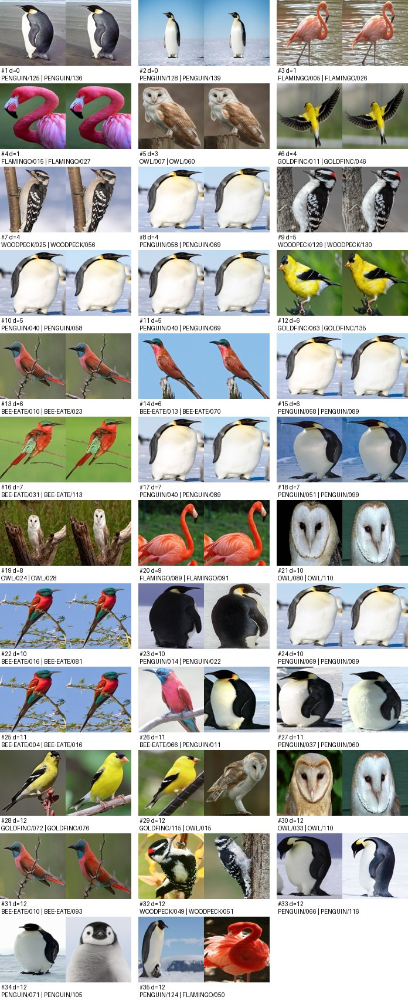

# P3 · Dataset as a product

**Bird Speciees Dataset with the P2 codec pipeline** · IDIG4120 · Aksel Wiersdalen and Fredrik Svendsrud · 6 November 2026
Repository: <https://github.com/Fredrik321/Digital-information-processing>, folder `p3/` (start with `p3/README.md`)

Everything below can be checked by another pair with three commands from the `p3` folder: `python -m venv .venv`, `pip install -r requirements.txt`, `python run.py`. The run verifies every input file against the manifest, enforces the schema, writes the QA report, runs the codec on a seeded subset, and compares the result with the sizes we reported in P2. Sources in the datasheet are abbreviated: **[M]** `manifest.csv`, **[S]** `schema.json`, **[QA]** `outputs/qa/qa_report.json`, **[R]** `qa_review.csv`, **[P1]** our P1 report.

## 1 Datasheet

Where the source does not answer, the entry says *unknown*; where we could not find the source at all, *unresolved*. Statements marked *(our decision)* are choices we made, not facts about the data.

### Identity and purpose

| item | answer | evidence / source |
|---|---|---|
| Title | "Bird Speciees Dataset", spelled as received; every path depends on the folder name, so we kept it | folder name, [M] |
| Version | Version 1 |([dataset source](https://www.kaggle.com/datasets/rahmasleam/bird-speciees-datasett))|
| Owner / creator | The owner of the dataset is *Rahma Sleam*, whom posted the dataset to kaggle |([dataset source](https://www.kaggle.com/datasets/rahmasleam/bird-speciees-datasett)) |
| Intended uses | On the kaggle page the author says the following in terms of usage: *This dataset can be used for tasks like image recognition, species identification, and model training in deep learning applications.*| ([dataset source](https://www.kaggle.com/datasets/rahmasleam/bird-speciees-dataset)) |
| Out-of-scope uses | **unknown:** In this area nothing was mentioned by the author | ([dataset source](https://www.kaggle.com/datasets/rahmasleam/bird-speciees-dataset)) |
| Unit of observation | one 224×224 RGB JPEG of one bird, labelled with one species by its folder | [S] |

### Collection and sampling

| item | answer | evidence / source |
|---|---|---|
| Who or what is represented | six species: American Goldfinch 143, Barn Owl 129, Carmine Bee-eater 131, Downy Woodpecker 137, Emperor Penguin 139, Flamingo 132 | [S], [QA] |
| When and how | **unknown:** No file carries EXIF or other capture metadata, and documentation is lacking| [QA]: 0 of 811 files have EXIF |
| Sampling frame | **unknown** | — |
| Exclusions | **unknown** | — |
| Known gaps (observed) | only six species; near-equal class sizes (129–143) point to curated selection rather than natural frequency; some images are drawings or cut-outs on a plain white background, not photographs; backgrounds differ systematically by species (snow, water, foliage); 21 files are near-duplicate copies (§3); sex, age, location and photographer are unknown (one image we reviewed, `EMPEROR PENGUIN/105.jpg`, is a chick) | [P1], [QA], [R] |

### Labels and transformations

| item | answer | evidence / source |
|---|---|---|
| Who produced the labels | **unknown:** No information is given as to *who* labeled the data | [S] |
| Label quality | not verified. Weak evidence only: no near-duplicate pair crosses two classes (3 cross-class candidates were reviewed, all different photos) | [R] |
| Cleaning, filtering, resampling | who and how: unknown. Evidence that every file went through the same processing step: all 811 are exactly 224×224, baseline JPEG, 4:2:0 chroma subsampling, with identical quantisation tables matching IJG quality 95 and a bare JFIF header without EXIF. Duplicate pairs with different crops show the same photo was cropped and resized more than once | [QA] `encoding`, [R] |
| Derived fields | none shipped. We derive the class (from the folder), decoded arrays, the manifest, the QA report and the codec results | — |
| Was the original kept | the upstream originals were not: original resolution and metadata are absent (whether they still exist is unknown). Our copy is never modified; the manifest pins it as received | [M] |

### Rights and privacy

| item | answer | evidence / source |
|---|---|---|
| Licence and attribution | Licenced under *Apache 2.0*. Attribution: requires shipping the licence text, retaining original notices, and marking any changes we make; seemingly no NOTICE file is given for the dataset. Personal/sensitive data are also unknown. Access/retention/deletion also unknown. The dataset has in no way been modified by us| ([dataset source](https://www.kaggle.com/datasets/rahmasleam/bird-speciees-dataset)) |
| Personal or sensitive data | no file has EXIF, so there are no GPS positions, camera serials or timestamps. No people are depicted in the images: only birds| [QA], [R] |
| Access | our copy is committed to a **public** GitHub repository | repository settings |
| Retention | *(our decision)* until the portfolio is graded, then removed | — |
| Deletion | delete `Bird Speciees Dataset/` and `p3/cache/`. Copies remain in git history and any forks until the history is rewritten | — |

### Quality and integrity

| item | answer | evidence / source |
|---|---|---|
| Units and valid ranges | `uint8` 0–255; 8-bit gamma-encoded sRGB code values with no physical unit; shape (224, 224, 3), axes height, width, channel (R, G, B) | [S], [P1] |
| How missing values appear | a decoded JPEG cannot have missing pixels, so we checked for what can be missing: 0 zero-byte files, 0 undecodable files, 0 blank images, 0 non-RGB files. Capture metadata is missing from all 811 | [QA] |
| Duplicates | 0 exact duplicates (bytes or decoded pixels). 24 near-duplicate pairs in 17 groups: 38 files, 21 of them redundant copies, all within one class | [QA], [R] |
| Manifest and hash checks | `manifest.csv` and `SHA256SUMS`, 811 entries; checked by `run.py` on every run and independently by `sha256sum -c` (811 OK). Decoded-pixel digest `cb5f6549…`, identical under two Pillow/libjpeg-turbo versions | [M], §4 |

### Use and maintenance

| item | answer | evidence / source |
|---|---|---|
| Versioning | none upstream. We version our snapshot by the manifest digest; any change to the files means rebuilding `manifest.csv` and recording the new digest in the README | [M] |
| Named maintainer | Aksel Wiersdalen and Fredrik Svendsrud, for the duration of IDIG4120, autumn 2026 | — |
| Decision | **Use with controls** for this course's compression and representation work. Controls: verify the manifest before every run; report codec results per image and per class, not only in aggregate; drop or group the 21 duplicate copies before any train/test split; make the repository private, or remove the images, until the licence is known. For any use outside the course: **investigate**, starting with licence and provenance | §3, §9, §10 |
| Reviewed by | [NAME], [NAME] · [DATE] | |

## 2 Schema

`schema.json` is the contract; `validate.py` enforces every field and stops the run with exit code 4 on the first file that breaks it.

| field | contract |
|---|---|
| layout | `<class>/<NNN>.jpg`, file names matching `^[0-9]{3}\.jpg$`, no files outside a class folder |
| classes | exactly the six names above, with exactly the listed count each (811 in total) |
| file | format JPEG, mode RGB **before** any conversion, 224 × 224 |
| array | shape (224, 224, 3), dtype `uint8`, values 0–255, axes H, W, C (R, G, B) |
| batch | shape (N, 224, 224, 3), `uint8`, in manifest order (sorted relative path) |

One deliberate change from our P1/P2 loader: it called `.convert("RGB")`, which would silently turn a greyscale or CMYK file into RGB. The validator checks the mode first and rejects such a file instead (tested in §8). The schema covers structure only: it cannot tell a mislabelled bird, a drawing or a duplicate from a valid photo; those are QA questions.

## 3 Quality-assurance report

`qa.py` writes `outputs/qa/qa_report.json`, a Markdown version and a contact sheet of the near-duplicate candidates.

| check | result |
|---|---|
| missing: zero-byte / undecodable / blank / non-RGB files | 0 / 0 / 0 / 0 |
| missing: files with EXIF or capture metadata | 0 of 811 |
| ranges: pixel values | 0–255; 742 images reach 0, 671 reach 255 |
| ranges: per-image mean (min / median / max) | 43.3 / 118.7 / 243.5 |
| ranges: per-image standard deviation | 25.6 / 56.2 / 98.1 (no flat images) |
| ranges: file size in bytes | 6,067 / 19,202 / 35,493 |
| duplicates: exact, by file bytes / by decoded pixels | 0 / 0 |
| duplicates: near-duplicate candidates (dHash distance ≤ 12) | 35 pairs, all reviewed by eye |
| duplicates: confirmed near-duplicates | 24 pairs → 17 groups, 38 files, **21 redundant copies**; none across classes |
| corrupt: `verify()` failures / full-decode failures / missing JPEG end marker | 0 / 0 / 0 |
| encoding | 811 × JPEG, RGB, 224×224, IJG quality 95 |

**Near-duplicates.** Exact hashing says the dataset has no duplicates, and that is not true. We compared a 64-bit difference hash (dHash, robust to re-encoding and small crops) for all 328,455 pairs and looked at every pair within distance 12:

| dHash distance | pairs | duplicates | not duplicates |
|---|---|---|---|
| 0–6 | 15 | 15 | 0 |
| 7–10 | 9 | 7 | 2 |
| 11–12 | 11 | 2 | 9 |

The duplicates are the same photo cropped, shifted or zoomed slightly differently, not re-saved copies; one penguin photo appears four times (`040`, `058`, `069`, `089`). Duplicates were still found at distance 12, so we do not know how many lie beyond it: the count of 21 is a lower bound. The verdicts are in `qa_review.csv` and are read back into the report.



**Where the QA stops being reliable.** It cannot see mislabelled species, drawings among photographs, or different photos of the same bird taken seconds apart. The duplicate count is a lower bound. Range statistics describe the JPEG-decoded values, which already carry the compression of an unknown earlier pipeline.

## 4 Manifest

`manifest.py build` lists every file under the dataset root, hidden files included, as a relative POSIX path with its byte size and SHA-256, in sorted order. It writes the same information twice: `manifest.csv` for our code and `SHA256SUMS` in the standard `sha256sum` format. The manifest is independent of the pipeline in two senses. It was generated once and committed, so a run never trusts what it computes about itself. It can also be checked with a standard tool that shares no code with ours:

```
cd "Bird Speciees Dataset" && sha256sum -c ../p3/SHA256SUMS      → 811 × OK
```

| item | value |
|---|---|
| entries / total bytes | 811 / 15,967,831 |
| `manifest.csv` SHA-256 | `6af9010bab12a83348f0ef68bdf416de97bb5564bd7cd2e300d554f3b83448c3` |
| `SHA256SUMS` SHA-256 | `4811d2bd64322957bf48f806b7a0265f24c9fde056473bd66a4215ff3da96f38` |
| decoded pixels SHA-256 (all 811, manifest order) | `cb5f65495c5cfc3f9496d58c9bdc9f4f0b94ffeb7fb5cbd99eaf1e8f66d8de71` |

`run.py` verifies the manifest before anything else: a listed file that is missing stops the run with exit 2; a changed size or digest, or a file the manifest does not list, stops it with exit 3. The decoded-pixel digest adds one more layer: two machines with identical files can still decode different pixels if their JPEG libraries differ. We checked it under Pillow 10.2.0 (libjpeg-turbo 3.0.1) and Pillow 11.1.0 (3.1.0) and got the same digest. `.gitattributes` keeps these files LF-terminated, because our git is set to `core.autocrlf=true` and a CRLF checkout would change their digests.

## 5 Entry point and the test pipeline

```
python run.py                            # test pipeline, 14 images (config.json)
python run.py --config config_full.json  # the same pipeline on all 811 images
```

`run.py` is the only entry point. In order, it: (1) verifies the manifest; (2) validates all 811 files against the schema and computes the decoded-pixel digest; (3) writes the QA report; (4) selects a stratified subset (2 images per class drawn with seed 4120, plus P2's two reference images `AMERICAN GOLDFINCH/001.jpg` and `FLAMINGO/132.jpg`: 14 images); (5) compresses each image with all five codec variants, decompresses, and asserts an exact round trip and the codec named in the container header; (6) writes `results.csv`, `summary.json`, `timings.csv` and `run.json`; (7) compares the sizes with those reported in P2.

`results.csv` and `summary.json` hold only deterministic values, so their digests are a one-line reproducibility check; times and memory go to `timings.csv` and `run.json`.

Result of the test pipeline (14 images, 2,107,392 raw bytes; every container includes its 293-byte header):

| variant | total bytes | ratio | per-image ratio, median [min–max] |
|---|---|---|---|
| Huffman, raw bytes | 1,911,150 | 1.103 | 1.085 [1.039–1.349] |
| Huffman + horizontal delta | 1,154,376 | 1.826 | 1.774 [1.581–2.423] |
| Huffman + vertical delta | 1,244,191 | 1.694 | 1.668 [1.455–2.270] |
| PNG | 954,315 | 2.208 | 2.086 [1.784–3.279] |
| zlib-6 in our container | 1,340,585 | 1.572 | 1.505 [1.178–2.351] |

The reference check reproduces every size P2 reported, to the byte: `001.jpg` Huffman 144,569, Huffman+horizontal 94,637, PNG 81,979, raw zlib-6 105,908; `132.jpg` Huffman 144,854, PNG 84,397.

**To reproduce:** with the pinned environment, a correct run prints `results.csv sha256 13e7b955…` and `summary.json sha256 fd0e1b8b…` (full digests are in `outputs/test/run.json`).

## 6 Environment, dependencies, configuration, seed and logs

| item | value |
|---|---|
| Python | 3.11.9 (CPython), Windows 11, x86-64 |
| dependencies (`requirements.txt`) | `numpy==2.1.3`, `pillow==11.1.0` (bundles zlib-ng 1.3.1 and libjpeg-turbo 3.1.0); everything else is standard library |
| configuration | `config.json` (test) and `config_full.json` (all images); relative paths resolve against the config file, so the run works from any folder |
| seed | `4120`, used only to draw the subset (`numpy.random.default_rng`). Everything else is deterministic: sorted paths, Huffman tie-breaking by frequency then insertion order, fixed PNG and zlib levels |
| logs | `logs/<run>_<timestamp>.log`, about 20 lines: environment, config digest, manifest and schema results, progress, per-variant totals, output digests, time and peak memory |

**Fresh-environment check.** We copied only the files that would be committed, plus the dataset, into a new folder, created a new venv from `requirements.txt`, and ran `run.py`. It finished with exit 0, and `results.csv` and `summary.json` had the same SHA-256 as ours (`13e7b955…`, `fd0e1b8b…`).

**The environment matters, and the run detects it.** The pinned versions are the ones P2 used. We ran the same package under the Python already installed on this machine (NumPy 1.26.3, Pillow 10.2.0 with zlib 1.3). The run warned about both versions and stopped with exit 5: `AMERICAN GOLDFINCH/001.jpg png: 81983 bytes, reference 81979`. Comparing the two `results.csv` files column by column: the subset was the same, every Huffman and zlib size and the decoded-pixel digest were identical, and only the PNG column differed, on 12 of 14 images, by −1 to +137 bytes. The difference comes from the zlib inside Pillow, not from our code or the data. Without the pinned versions and the reference check, this would have looked like a reproduction.

Log of the test run (`logs/test_20261102-171456.log`, progress lines omitted):

```
17:14:56 INFO    config config.json (sha256 405d43b10c5e7d4b), seed 4120
17:14:56 INFO    env python 3.11.9 | numpy 2.1.3 | pillow 11.1.0 (zlib 1.3.1.zlib-ng, libjpeg-turbo 3.1.0) | Windows-10-10.0.26300-SP0
17:14:57 INFO    manifest OK: 811 files, 15,967,831 bytes (manifest sha256 6af9010bab12a833)
17:14:58 INFO    schema OK: 811 files are JPEG RGB (224, 224, 3); decoded pixels sha256 cb5f65495c5cfc3f
17:15:03 INFO    qa: 0 exact duplicate groups, 24 near-duplicate pairs confirmed in 17 groups (21 redundant files), 0 corrupt
17:15:03 INFO    subset: 14 images (per_class=2, seed 4120), variants huffman, huffman+horizontal, huffman+vertical, png, zlib-6
17:15:18 INFO    png                  total     954,315 bytes  ratio 2.208  per-image median 2.086 [1.784-3.279]
17:15:18 INFO    results.csv sha256 13e7b955ae5ba053, summary.json sha256 fd0e1b8bec39ae87
17:15:18 INFO    reference check OK: P2's reported sizes reproduced exactly
17:15:18 INFO    done in 21.7 s, peak memory 92 MiB
```

## 7 Timing and memory evidence

**Storage choice: how should the pipeline hold the decoded images?** P1 and P2 decoded every JPEG into one in-memory list. `bench.py` compares three options: decoding the JPEG folder each time; one uncompressed `.npy` cache (the P2 baseline array on disk); and the same `.npy` memory-mapped read-only. Each option runs two workloads: a full pass over all 811 images, and fetching the 14 test-pipeline images. Every measurement runs in a fresh process: one warm-up, then the median of 5 runs. RSS is the growth of the process's peak working set. Heap is the peak of traced Python/NumPy allocations, from a separate run, because `tracemalloc` slows the code it watches.

| storage (disk size) | workload | median time | RSS increase | heap peak |
|---|---|---|---|---|
| JPEG folder (15.97 MB) | all 811 | 1.369 s | 118 MiB | 117 MiB |
| `.npy`, loaded (122.08 MB) | all 811 | 0.761 s | 117 MiB | 117 MiB |
| `.npy`, memory-mapped | all 811 | 0.773 s | 115 MiB | 0.1 MiB |
| JPEG folder | 14 images | 0.035 s | 2.7 MiB | 3.0 MiB |
| `.npy`, loaded | 14 images | 0.065 s | 118 MiB | 119 MiB |
| `.npy`, memory-mapped | 14 images | 0.015 s | 3.1 MiB | 2.1 MiB |

Reading the table:
- For a full pass, the `.npy` is 1.8× faster than decoding JPEGs, at 7.6× the disk space, and with the same memory.
- For the test pipeline's 14 images, loading the `.npy` is the worst option: the whole 122 MB array must be read to use 1.7 % of it, which takes 39× the memory of the other two.
- Memory-mapping gets the best of both. It matches the full load for a full pass and is fastest for a subset. Its pages are file-backed, so they show up in RSS but not in the heap, and the OS can drop them under memory pressure.

**Decision.** We keep the JPEG files as the stored form and the source of truth. They are what the manifest pins, 7.6× smaller, and a subset costs 35 ms to decode, which is negligible next to roughly 1 s of codec work per image. The pipeline streams one image at a time, so the full 811-image run peaked at 49 MiB, against the 117 MiB a P1/P2-style load-everything list needs. A `.npy` cache pays off only for repeated full passes, such as training epochs. It should then be memory-mapped, and it must be checked against the decoded-pixel digest before use. `bench.py` does that check; otherwise the cache would be an unverified copy outside the manifest.

**Implementation fix found on the way.** P2's Huffman bit packer never trimmed its accumulator, so every shift copied a Python integer as large as the whole payload so far: quadratic time. P3 masks the accumulator after each byte is written:

| image (raw stream) | P2 packer | P3 packer | speed-up | heap peak P2 → P3 | output |
|---|---|---|---|---|---|
| `AMERICAN GOLDFINCH/001.jpg` | 6.58 s | 0.073 s | 90× | 598 → 288 KiB | byte-identical |
| `AMERICAN GOLDFINCH/033.jpg` | 6.39 s | 0.039 s | 165× | 549 → 262 KiB | byte-identical |
| `AMERICAN GOLDFINCH/076.jpg` | 6.15 s | 0.040 s | 155× | 599 → 289 KiB | byte-identical |

The containers are unchanged, which the reference check confirms, and the full-dataset run in §9 became practical. With the P2 packer it would have spent roughly three hours encoding alone, estimated from about 6.4 s for the raw stream and 3.5 s for each predicted stream per image. The whole run took 17.5 minutes.

Timings come from one Windows laptop (Python 3.11.9, warm file cache); the ratios between rows are what should carry over to other machines.

## 8 Failure handling

`test_failures.py` runs the real `run.py` on a temporary copy of the dataset, damages the copy in one way, and checks the exit code and the message. All 12 tests pass (`outputs/failure_tests.txt`), and the real dataset still matches the manifest afterwards.

| case | how it is simulated | stops at | exit | message (shortened) |
|---|---|---|---|---|
| missing input | delete `BARN OWL/007.jpg` | manifest | 2 | `1 file(s) listed in the manifest are missing: BARN OWL/007.jpg` |
| missing input | remove the dataset folder / config file | start | 2 | `dataset root not found` / `config file not found` |
| digest mismatch | flip one bit in the middle of the file (same size) | manifest | 3 | `BARN OWL/007.jpg: sha256 b847652e…, manifest says 9cfb1573…` |
| unlisted file | add a copy as `BARN OWL/999.jpg` | manifest | 3 | `1 file(s) are not in the manifest: BARN OWL/999.jpg` |
| invalid shape | replace with a 225×224 JPEG and **rebuild the manifest** | schema | 4 | `BARN OWL/007.jpg: size 225x224, expected 224x224` |
| invalid mode | replace with a greyscale JPEG, rebuild the manifest | schema | 4 | `BARN OWL/007.jpg: mode L, expected RGB` |
| corrupt file | truncate to 5,000 bytes, rebuild the manifest | schema | 4 | `BARN OWL/007.jpg: cannot decode (OSError: …truncated…)` |
| interrupted run | `--stop-after 2`, then a torn half-line appended to the checkpoint | pipeline | 130 → 0 | `interrupted … Rerun the same command to resume`, then `dropped 1 incomplete line(s)`, `resuming: 2 of 6 images already done` |
| resume after a change | interrupt, then rerun with a different seed | pipeline | 1 | `checkpoint.jsonl belongs to a different run …; rerun with --fresh` |
| environment drift | reference PNG size from another Pillow build | reference check | 5 | `AMERICAN GOLDFINCH/001.jpg png: 81979 bytes, reference 81983` |

The shape, mode and truncation tests rebuild the manifest on purpose. Otherwise the digest check would catch the change first. Rebuilding the manifest simulates a provider who recorded a bad file faithfully, and shows that the schema still catches it: a manifest proves the bytes are the ones recorded, not that they are right.

**Interrupted runs.** Each finished image is appended to `checkpoint.jsonl` and flushed to disk (`fsync`) before the next one starts. Final outputs are written to a temporary file and renamed into place, so a crash leaves either no `results.csv` or a complete one, never half of one. On restart, a line torn by the crash is dropped and that image is redone. The checkpoint starts with a key built from the subset, variants, manifest digest and code digest; a checkpoint from a different run is refused rather than mixed in. Ctrl+C takes the same path as `--stop-after` and exits with 130. The test also checks that the resumed `results.csv` is byte-identical to one from an uninterrupted run.

## 9 Codec results on the whole dataset (P2 feedback)

The P2 feedback made two points; this pipeline addresses both.

**Equal framing for the baseline.** zlib is now `codec_id 2` inside our own container. All five variants therefore carry the same 293-byte header (dtype, shape, byte count, CRC, codec and predictor ids), and their totals differ only in payload. Framing costs zlib exactly 293 bytes per image: its aggregate ratio moves from 1.515 to 1.511, and it changes which of Huffman+horizontal and zlib is smaller on 6 of 811 images. No conclusion changes. We kept the P2 header unchanged so that P2's sizes still reproduce. That means PNG and zlib containers carry the 256 Huffman code-length bytes they do not use: 0.35 % of the PNG total, a small handicap against us.

**The whole dataset, not two images.** `python run.py --config config_full.json` ran all five variants on all 811 images and asserted an exact round trip for every container (4,055 round trips) in 17.5 minutes. Raw total: 122,078,208 bytes.

| variant | total bytes | ratio | bits/byte | per-image ratio, median [Q1–Q3] | min–max | smallest on |
|---|---|---|---|---|---|---|
| Huffman, raw bytes | 111,243,444 | 1.097 | 7.290 | 1.072 [1.043–1.129] | 0.999–3.449 | 0 |
| Huffman + horizontal | 71,007,198 | 1.719 | 4.653 | 1.716 [1.557–1.929] | 1.197–4.099 | 0 |
| Huffman + vertical | 73,082,316 | 1.670 | 4.789 | 1.664 [1.530–1.843] | 1.149–4.278 | 0 |
| PNG | 58,730,816 | 2.079 | 3.849 | 2.066 [1.837–2.426] | 1.297–9.896 | 811 |
| zlib-6 in our container | 80,797,251 | 1.511 | 5.295 | 1.508 [1.304–1.775] | 1.032–7.372 | 0 |

| class (aggregate ratio) | n | Huffman | + horizontal | + vertical | PNG | zlib-6 |
|---|---|---|---|---|---|---|
| American Goldfinch | 143 | 1.077 | 1.745 | 1.703 | 2.050 | 1.469 |
| Barn Owl | 129 | 1.079 | 1.619 | **1.647** | 1.959 | 1.414 |
| Carmine Bee-eater | 131 | 1.158 | 1.954 | 1.887 | 2.392 | 1.771 |
| Downy Woodpecker | 137 | 1.059 | 1.497 | **1.514** | 1.815 | 1.367 |
| Emperor Penguin | 139 | 1.112 | 1.889 | 1.736 | 2.451 | 1.787 |
| Flamingo | 132 | 1.108 | 1.693 | 1.585 | 1.952 | 1.371 |

What the whole dataset shows that two images could not:

- **P2's main comparison holds in aggregate but not on every image.** Huffman+horizontal is smaller than zlib-6 on 681 of 811 images (84 %). The median saving is 11.6 %, but the per-image difference ranges from 34.9 % smaller to 79.9 % larger. zlib wins on images with large uniform areas. On `EMPEROR PENGUIN/076.jpg`, a cut-out bird on a plain white background, zlib needs 20,419 bytes and Huffman+horizontal 36,724. LZ77 can encode a long run of identical bytes as one match, while a zero-order Huffman code must spend at least one bit on every byte.
- **PNG is the smallest variant on all 811 images**, and raw-byte Huffman is never smaller than zlib (0 of 811). On one image (`AMERICAN GOLDFINCH/112.jpg`) the raw-byte Huffman container is 0.1 % larger than the array itself.
- **The best predictor depends on the image.** The vertical delta beats the horizontal one on 281 images (35 %), and on average for the Barn Owl and Downy Woodpecker classes (bold above), so `predictor: "auto"` earns its cost.
- **One number hides a wide spread.** PNG ranges from 1.30 (`FLAMINGO/009.jpg`) to 9.90 (`EMPEROR PENGUIN/076.jpg`) per image. The best-compressing images (`EMPEROR PENGUIN/076.jpg`, `FLAMINGO/116.jpg`) are cut-outs on plain white backgrounds, not natural photographs. The worst are dominated by grass, bark or foliage texture.
- **Our P2 test images were harder than typical.** `001.jpg` sits at the 24th–30th percentile and `132.jpg` at the 20th–29th for Huffman, Huffman+horizontal and PNG. P2's per-image numbers therefore understate the dataset median: Huffman+horizontal gave 1.591 on `001.jpg`; the dataset median is 1.716.
- **The class differences follow the backgrounds.** Penguins and bee-eaters, often against snow or open sky, compress best; woodpeckers on bark compress worst. This is the background effect from our P1 concern, now measured. A codec comparison on one class would not carry over to another.- **Duplicates barely move these numbers.** Dropping the 21 redundant copies changes every aggregate ratio by less than 0.2 %, because each image is compressed on its own. For codec results the duplicates are harmless; for anything that splits the data into training and test sets they are not (§10).

**To reproduce:** `outputs/full/results.csv` has every per-image size. A correct full run prints `results.csv sha256 bd56dcd7…` and `summary.json sha256 2517f481…`.

## 10 Known limitations

- **Provenance and licence are unresolved**, and the images sit in a public repository. This is the largest open problem. It does not affect the technical results, but it limits who may use the package.
- **Duplicates are a lower bound.** 21 redundant copies were confirmed; duplicates were still found at the edge of what we reviewed. Any classifier result on this data, including our P1 random forest (46.8 %), may be inflated if copies of one photo land on both sides of a train/test split. We have not re-run that experiment.
- **Representativeness is unknown**: six species, curated class sizes, systematic background differences, some drawings and cut-outs on white backgrounds, every file re-encoded at quality 95 by an unknown pipeline.
- **Codec results are for JPEG-decoded pixels.** The images already carry JPEG artefacts, so these ratios say little about lossless compression of camera originals.
- **PNG and zlib sizes depend on the library build.** Huffman sizes are reproducible everywhere; PNG sizes need the pinned Pillow, and the run reports a mismatch instead of hiding it.
- **Timings come from one Windows laptop with a warm file cache.** The relative differences are what carry over to another machine, not the absolute numbers.
- **The schema covers structure, not meaning**, and the QA report describes the data but does not judge the labels.

## 11 Maintenance, responsibilities and AI declaration

**Maintainers:** Aksel Wiersdalen and Fredrik Svendsrud maintain this snapshot for the course period (until the portfolio is graded, autumn 2026). Contact through the repository. A change to any dataset file requires a rebuilt manifest, a new digest in the README, and a rerun of `run.py` and `test_failures.py`.

**Who did what:** [TO FILL IN by Aksel and Fredrik.]

**Generative AI declaration:** [TO REVIEW AND EDIT.] As in P1 and P2, we used AI for most of the code. For P3, Claude (Anthropic, through Claude Code) wrote the code in `p3/` (codec module, manifest, schema checker, QA, entry point, benchmark and failure tests), ran the experiments, proposed the near-duplicate verdicts in `qa_review.csv` from visual inspection, and drafted this report and the datasheet. We checked [WHAT YOU CHECKED], confirmed the duplicate verdicts, and edited the text. Every number in the report comes from files in `p3/outputs/` that `run.py`, `qa.py`, `bench.py` and `test_failures.py` regenerate.
